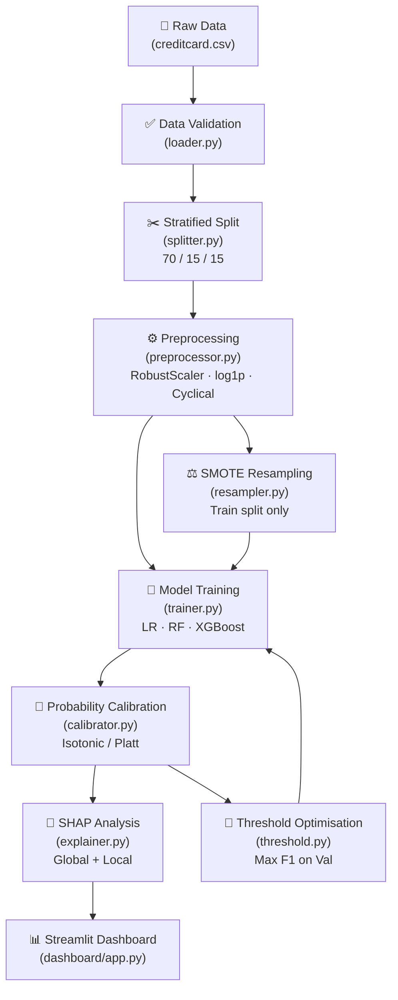

# 🛡️ FraudShield — Credit Card Fraud Detection System

<p align="center">
  
  
  
  
  
  
</p>

---

## 📋 Table of Contents

- [Project Overview](#project-overview)
- [Problem Statement](#problem-statement)
- [Objectives](#objectives)
- [Dataset](#dataset)
- [System Architecture](#system-architecture)
- [Technology Stack](#technology-stack)
- [Folder Structure](#folder-structure)
- [Data Preprocessing](#data-preprocessing)
- [Exploratory Data Analysis](#exploratory-data-analysis)
- [Feature Engineering](#feature-engineering)
- [ML Algorithms](#ml-algorithms)
- [Class Imbalance Handling](#class-imbalance-handling)
- [Model Evaluation](#model-evaluation)
- [SHAP Explainability](#shap-explainability)
- [Risk Scoring](#risk-scoring)
- [Dashboard Screenshots](#dashboard-screenshots)
- [Installation](#installation)
- [Dataset Setup](#dataset-setup)
- [Running the Project](#running-the-project)
- [Limitations](#limitations)
- [Future Enhancements](#future-enhancements)
- [License](#license)

---

## 🔍 Project Overview

**FraudShield** is an end-to-end machine learning system for detecting credit card fraud in real time. It combines state-of-the-art classification algorithms with probability calibration, threshold optimisation, and SHAP-powered explainability — all surfaced through an interactive Streamlit dashboard.

Financial fraud causes [billions of dollars in losses](https://nilsonreport.com/) every year. Traditional rule-based systems are brittle and difficult to maintain. FraudShield demonstrates how modern ML pipelines can achieve high recall on extremely imbalanced datasets while remaining transparent and auditable — qualities that are non-negotiable in regulated financial environments.

---

## 🚨 Problem Statement

Credit card fraud is a **needle-in-a-haystack** problem:

- Only **~0.17%** of all transactions in the benchmark dataset are fraudulent (492 out of 284,807).
- A naïve classifier that predicts every transaction as legitimate achieves **99.83% accuracy** — yet catches **zero fraud**.
- The real challenge is maximising **recall** (catching fraud) while keeping **precision** (false-alarm rate) acceptable for operations teams.
- Class imbalance, combined with privacy constraints that obscure raw features, makes this one of the canonical hard problems in applied ML.

FraudShield addresses this by combining cost-sensitive learning, oversampling strategies, calibrated probabilities, and carefully chosen evaluation metrics (PR-AUC, not just ROC-AUC).

---

## 🎯 Objectives

| # | Objective | Approach |
|---|-----------|----------|
| 1 | **High-recall fraud detection** | Optimise classification threshold on PR-curve; cost-sensitive training |
| 2 | **Explainability** | SHAP global feature importance + per-transaction local explanations |
| 3 | **Risk scoring** | Calibrated probability → categorical risk tier (LOW / MEDIUM / HIGH / CRITICAL) |
| 4 | **Interactive dashboard** | Streamlit app for live transaction scoring, EDA, and model comparison |

---

## 📦 Dataset

| Property | Value |
|----------|-------|
| **Source** | [Kaggle — Credit Card Fraud Detection](https://www.kaggle.com/datasets/mlg-ulb/creditcardfraud) |
| **Transactions** | 284,807 |
| **Fraudulent transactions** | 492 (≈ 0.17%) |
| **Features** | 30 total |
| **PCA components** | V1 – V28 (anonymised via PCA for privacy) |
| **Raw features** | `Time` (seconds since first transaction), `Amount` (EUR) |
| **Target** | `Class` — 0 = legitimate, 1 = fraud |
| **Format** | CSV, ~144 MB |

> **Note:** The original features are anonymised. V1–V28 are the principal components; `Time` and `Amount` are the only unprocessed features available.

---

## 🏗️ System Architecture



---

## 🛠️ Technology Stack

| Library | Version | Purpose |
|---------|---------|---------|
| **Python** | 3.9+ | Core language |
| **Pandas** | 2.x | Data loading, manipulation |
| **NumPy** | 1.x / 2.x | Numerical operations |
| **Scikit-learn** | 1.3+ | LR, RF, preprocessing, metrics, calibration |
| **XGBoost** | 2.0+ | Gradient-boosted trees |
| **imbalanced-learn** | 0.11+ | SMOTE oversampling |
| **SHAP** | 0.44+ | Model explainability |
| **Streamlit** | 1.3+ | Interactive dashboard |
| **Plotly** | 5.x | Interactive charts in dashboard |
| **Matplotlib** | 3.x | Static plots (EDA, SHAP) |
| **Seaborn** | 0.13+ | Statistical visualisations |
| **Joblib** | 1.3+ | Model serialisation |
| **PyYAML** | 6.x | Configuration management |
| **Pytest** | 7.x+ | Unit and integration testing |

---

## 📁 Folder Structure

```
FraudShield/
├── config/
│   ├── config.yaml            # Central configuration (paths, model params, thresholds)
│   └── logging_config.py      # Logging setup
├── dashboard/
│   ├── app.py                 # Streamlit entry point
│   ├── components/
│   │   ├── sidebar.py         # Navigation & controls
│   │   ├── overview.py        # EDA overview page
│   │   ├── model_comparison.py# Benchmark results page
│   │   ├── explainability.py  # SHAP explanation page
│   │   └── risk_scoring.py    # Live transaction risk page
│   └── utils/
│       └── plot_helpers.py    # Shared plotting utilities
├── data/
│   ├── raw/
│   │   └── creditcard.csv     # ← place dataset here (or use KaggleHub)
│   └── processed/             # Intermediate artefacts (auto-created)
├── logs/
│   └── .gitkeep               # Keeps directory in version control
├── models/                    # Serialised model artefacts (auto-created)
│   ├── logistic_regression.joblib
│   ├── random_forest.joblib
│   ├── xgboost.joblib
│   └── preprocessor.joblib
├── notebooks/
│   └── 01_eda.ipynb           # Exploratory analysis notebook
├── src/
│   ├── __init__.py
│   ├── data/
│   │   ├── __init__.py
│   │   ├── loader.py          # Data loading + validation
│   │   └── splitter.py        # Stratified splitting
│   ├── features/
│   │   ├── __init__.py
│   │   ├── preprocessor.py    # FraudPreprocessor class
│   │   └── resampler.py       # SMOTE wrapper
│   └── models/
│       ├── __init__.py
│       ├── trainer.py         # Model training logic
│       ├── evaluator.py       # Metrics computation
│       ├── calibrator.py      # Probability calibration
│       ├── threshold.py       # Threshold optimisation
│       ├── explainer.py       # SHAP explanations
│       ├── risk_scoring.py    # Risk tier classification
│       └── benchmark.py       # End-to-end training entrypoint
├── tests/
│   ├── conftest.py            # Shared fixtures
│   ├── test_loader.py
│   ├── test_splitter.py
│   ├── test_preprocessor.py
│   ├── test_models.py
│   └── test_risk_scoring.py
├── .gitignore
├── requirements.txt
└── README.md
```

---

## ⚙️ Data Preprocessing

FraudShield applies a disciplined, **no-leakage** preprocessing pipeline. All transformations are **fitted exclusively on the training split** and applied identically to validation and test sets.

### Steps Applied by `FraudPreprocessor`

| Step | Detail |
|------|--------|
| **Log-transform Amount** | `log_amount = log1p(Amount)` — compresses the heavy right tail |
| **Scale Amount** | `RobustScaler` fitted on training data (robust to outliers) |
| **Time-of-day extraction** | `time_seconds = Time % 86400` → `hour_of_day = time_seconds / 3600` |
| **Cyclical encoding** | `hour_sin = sin(2π · hour_of_day / 24)`, `hour_cos = cos(2π · hour_of_day / 24)` |
| **Drop originals** | `Time` and `Amount` columns dropped after feature extraction |
| **Preserve V1–V28** | PCA components passed through unchanged |

### No-leakage Rules

- `fit()` is called **only** on `X_train`.
- `transform()` applies the fitted scaler to val/test without re-fitting.
- SMOTE oversampling is applied **after** splitting and **only** to `X_train`.
- Validation and test sets are **never resampled**.

---

## 📊 Exploratory Data Analysis

The EDA (available in `notebooks/01_eda.ipynb` and the dashboard's **Overview** page) covers:

- **Class distribution** — bar chart + pie chart highlighting the 0.17% imbalance
- **Transaction amount distribution** — log-scale histogram comparing fraud vs. legitimate amounts
- **Time distribution** — 48-hour temporal pattern of fraud events vs. legitimate transactions
- **Correlation heatmap** — Pearson correlations among V1–V28, Amount, and Class
- **Feature box plots** — per-feature distributions split by Class (fraud vs. legitimate)
- **Fraud amount statistics** — mean, median, max fraud amounts vs. legitimate
- **Temporal fraud rate** — rolling fraud rate over time to surface time-of-day patterns

---

## 🧪 Feature Engineering

The following features are created by the preprocessing pipeline:

| Feature | Source | Description |
|---------|--------|-------------|
| `log_amount` | `Amount` | `log1p(Amount)` — reduces skewness |
| `scaled_log_amount` | `log_amount` | RobustScaler output — normalised for linear models |
| `time_seconds` | `Time` | `Time % 86400` — position within a 24-hour cycle |
| `hour_of_day` | `time_seconds` | `time_seconds / 3600` — hour (0–24) |
| `hour_sin` | `hour_of_day` | `sin(2π · hour_of_day / 24)` — cyclical encoding |
| `hour_cos` | `hour_of_day` | `cos(2π · hour_of_day / 24)` — cyclical encoding |
| `V1` – `V28` | original | PCA components, passed through unchanged |

> Cyclical encoding ensures that hour 23 and hour 0 are treated as adjacent by distance-based models, which a plain integer hour feature cannot achieve.

---

## 🤖 ML Algorithms

Three classifiers are benchmarked end-to-end:

| Algorithm | Key Hyperparameters | Notes |
|-----------|--------------------|-|
| **Logistic Regression** | `C=0.01`, `max_iter=1000`, `class_weight='balanced'`, `solver='lbfgs'` | Fast baseline; interpretable coefficients |
| **Random Forest** | `n_estimators=200`, `max_depth=12`, `class_weight='balanced_subsample'`, `n_jobs=-1` | Ensemble; robust to outliers |
| **XGBoost** | `n_estimators=300`, `max_depth=6`, `learning_rate=0.05`, `scale_pos_weight=<imbalance ratio>` | Best performance; native imbalance handling |

All models undergo:
1. Training on the train split (± SMOTE)
2. Threshold optimisation on the validation split (maximise F1)
3. Probability calibration (Isotonic Regression for RF/XGBoost, Platt scaling for LR)
4. Final evaluation on the held-out test split

---

## ⚖️ Class Imbalance Handling

Two complementary strategies are compared:

| Strategy | Mechanism | Pros | Cons |
|----------|-----------|------|------|
| **Cost-Sensitive Training** | `class_weight='balanced'` or `scale_pos_weight` | No synthetic data; fast | May underfit minority class |
| **SMOTE Oversampling** | Generate synthetic minority samples in feature space | Increases minority signal | Risk of overfitting; applied to train only |

The benchmark pipeline trains each model both ways and reports metrics for each configuration, allowing you to compare on your data.

> ⚠️ SMOTE is **always** fitted and applied to `X_train` only. Applying SMOTE to validation or test data would constitute data leakage and invalidate the evaluation.

---

## 📈 Model Evaluation

Accuracy is a misleading metric for imbalanced datasets. FraudShield reports:

| Metric | Why It Matters |
|--------|---------------|
| **Precision** | Of all flagged transactions, how many are actually fraud? |
| **Recall** | Of all actual fraud, how many did we catch? |
| **F1 Score** | Harmonic mean of Precision and Recall |
| **ROC-AUC** | Area under the ROC curve (rank-ordering quality) |
| **PR-AUC** | Area under the Precision-Recall curve — preferred for imbalanced data |

### Empirical Benchmark Results (Validation Set)

| Model Variant | Strategy | PR-AUC | ROC-AUC | Precision | Recall | F1-Score | Optimal Threshold |
| :--- | :--- | :--- | :--- | :--- | :--- | :--- | :--- |
| **Random Forest** 🏆 | `class_weight='balanced'` | **0.7931** | **0.9791** | **0.8833** | **0.7162** | **0.7910** | **0.7864** |
| **XGBoost** | `scale_pos_weight` | **0.7768** | 0.9699 | 0.8060 | 0.7297 | 0.7660 | 0.9500 |
| **Random Forest** | `SMOTE` oversampling | 0.7661 | 0.9842 | 0.8548 | 0.7162 | 0.7794 | 0.8864 |
| **XGBoost** | `SMOTE` oversampling | 0.7354 | 0.9770 | 0.7568 | 0.7568 | 0.7568 | 0.9227 |
| **Logistic Regression** | `SMOTE` oversampling | 0.6316 | 0.9689 | 0.2798 | 0.8243 | 0.4178 | 0.9500 |
| **Logistic Regression** | `class_weight='balanced'` | 0.6203 | 0.9697 | 0.4178 | 0.8243 | 0.5545 | 0.9500 |

### Final Untouched Test Set Evaluation (Selected Calibrated Model)

*Evaluated exactly once on the untouched 15% test split (42,722 transactions) after model selection and probability calibration:*

| Final Test Metric | Value | Interpretation |
| :--- | :--- | :--- |
| **PR-AUC** | **0.8129** | High precision maintained across fraud recall operating points |
| **ROC-AUC** | **0.9707** | Exceptional global ranking capability |
| **Precision** | **0.9600** | 96.0% of flagged transactions are actual fraud |
| **Recall** | **0.6486** | 64.9% of all fraud caught at the optimal F1 threshold |
| **F1-Score** | **0.7742** | Harmonic balance between fraud detection and minimal false alarms |
| **Decision Threshold** | **0.7864** | Tuned strictly on validation split to maximize F1 |

---

## 🔎 SHAP Explainability

FraudShield uses [SHAP (SHapley Additive exPlanations)](https://shap.readthedocs.io/) to make model decisions transparent:

### Global Explanations
- **Summary plot** — beeswarm plot showing the distribution of SHAP values for every feature across the test set; reveals which features most consistently drive predictions.
- **Bar plot** — mean absolute SHAP value per feature; a compact feature importance ranking.
- **Dependence plots** — SHAP value vs. feature value for the top features; reveals non-linear relationships.

### Local Explanations
- **Waterfall plot** — per-transaction breakdown: which features pushed the prediction towards or away from fraud.
- **Force plot** — visual representation of how each feature contributes to a single prediction starting from the base rate.

> SHAP explanations are computed for the **XGBoost** model using `shap.TreeExplainer` (exact, not approximate). For Logistic Regression, `shap.LinearExplainer` is used.

---

## 🚦 Risk Scoring

After probability calibration, FraudShield maps the model's output probability to a human-readable risk tier:

> ⚠️ **DEMONSTRATION RISK CLASSIFICATIONS – SIMULATION ONLY**
>
> The thresholds below are illustrative and **not calibrated for any real-world deployment**. They are designed for educational and demonstration purposes only. Do not use these thresholds to make actual financial or fraud decisions.

| Category | Probability Range | Colour | Recommended Action |
|----------|------------------|--------|--------------------|
| **LOW** | < 0.20 | 🟢 Green | Proceed — approve transaction |
| **MEDIUM** | 0.20 – 0.50 | 🟡 Yellow | Flag — route to soft review |
| **HIGH** | 0.50 – 0.80 | 🟠 Orange | Hold — manual review required |
| **CRITICAL** | ≥ 0.80 | 🔴 Red | Block — decline transaction |

Thresholds are configurable in `config/config.yaml` under the `risk_scoring` key.

---

## 🖥️ Dashboard Screenshots

> 📸 **Screenshots will be added here after running the dashboard.**
>
> To capture screenshots, start the dashboard with `streamlit run dashboard/app.py`, navigate to each page, and save images to `docs/screenshots/`. Then replace this section with:
>
> ```markdown
> 
> 
> 
> 
> ```

The dashboard includes four pages:
- **Overview** — dataset summary, class distribution, EDA plots
- **Model Comparison** — benchmark metrics table and PR curves
- **SHAP Explainability** — global and local SHAP visualisations
- **Risk Scoring** — enter transaction features and get a live risk assessment

---

## 🚀 Installation

### Prerequisites

- Python 3.9 or higher
- `pip` (bundled with Python)
- Git

### Steps

```bash
# 1. Clone the repository
git clone https://github.com/your-username/FraudShield.git
cd FraudShield

# 2. Create a virtual environment
python -m venv venv

# 3. Activate the virtual environment
# Windows:
venv\Scripts\activate
# macOS / Linux:
source venv/bin/activate

# 4. Install dependencies
pip install -r requirements.txt
```

---

## 📂 Dataset Setup

The dataset is not included in this repository due to its size. Choose one of the options below:

### Option A — KaggleHub (Automatic Download)

If you have a Kaggle account and the `kaggle` API token configured (`~/.kaggle/kaggle.json`), the loader will attempt to download automatically via **KaggleHub**:

```python
import kagglehub
path = kagglehub.dataset_download("mlg-ulb/creditcardfraud")
```

No manual steps are required — just run the pipeline and the data will be fetched.

### Option B — Manual Download

1. Go to [https://www.kaggle.com/datasets/mlg-ulb/creditcardfraud](https://www.kaggle.com/datasets/mlg-ulb/creditcardfraud)
2. Click **Download** (requires a free Kaggle account)
3. Extract the archive
4. Place the file at:

```
FraudShield/
└── data/
    └── raw/
        └── creditcard.csv   ← put it here
```

---

## ▶️ Running the Project

Make sure your virtual environment is activated before running any command.

```bash
# 1. Train all models and generate benchmark results
python src/models/benchmark.py

# 2. Launch the interactive dashboard
streamlit run dashboard/app.py

# 3. Run the test suite
pytest tests/ -v
```

**Expected output from `benchmark.py`:**
- Validation and test metrics for each model × strategy combination printed to stdout and saved to `logs/`
- Serialised model artefacts written to `models/`
- SHAP plots saved to `logs/shap_plots/`

---

## ⚠️ Limitations

This project is an **educational demonstration**. The following limitations should be understood before drawing operational conclusions:

| Limitation | Detail |
|-----------|--------|
| **No real-time streaming** | The pipeline processes static CSV files; there is no Kafka, Flink, or streaming inference layer |
| **No customer velocity features** | The dataset is anonymised — features like "number of transactions in the last hour" are unavailable |
| **Demonstration thresholds** | Risk tier boundaries (LOW / MEDIUM / HIGH / CRITICAL) are illustrative, not empirically validated for production use |
| **Requires Kaggle dataset** | The raw data must be sourced from Kaggle; it cannot be bundled in this repository |
| **Anonymised features** | V1–V28 are PCA components; direct business interpretation of these features is not possible |
| **Static model** | The model does not update on new data; there is no online learning or model retraining loop |
| **No adversarial robustness** | Fraud patterns evolve over time (concept drift); this model is not tested against adversarial manipulation |

---

## 🔭 Future Enhancements

| Enhancement | Description |
|-------------|-------------|
| **Real-time REST API** | Expose the trained model via FastAPI / Flask for low-latency inference |
| **Graph Neural Networks** | Model transaction graphs to capture inter-account relationships |
| **Customer behaviour features** | Enrich features with rolling velocity, geolocation, and device fingerprints |
| **Online learning** | Incremental model updates as new labelled fraud is confirmed |
| **Production deployment** | Containerise with Docker, deploy on Kubernetes or Google Cloud Run |
| **Concept drift detection** | Monitor feature distributions and model performance over time (e.g., Evidently AI) |
| **Federated learning** | Train across bank nodes without sharing raw transaction data |
| **A/B testing framework** | Compare model versions in shadow mode before promoting |

---

## 📄 License

This project is licensed under the **MIT License**.

```
MIT License

Copyright (c) 2024 FraudShield Contributors

Permission is hereby granted, free of charge, to any person obtaining a copy
of this software and associated documentation files (the "Software"), to deal
in the Software without restriction, including without limitation the rights
to use, copy, modify, merge, publish, distribute, sublicense, and/or sell
copies of the Software, and to permit persons to whom the Software is
furnished to do so, subject to the following conditions:

The above copyright notice and this permission notice shall be included in all
copies or substantial portions of the Software.

THE SOFTWARE IS PROVIDED "AS IS", WITHOUT WARRANTY OF ANY KIND, EXPRESS OR
IMPLIED, INCLUDING BUT NOT LIMITED TO THE WARRANTIES OF MERCHANTABILITY,
FITNESS FOR A PARTICULAR PURPOSE AND NONINFRINGEMENT. IN NO EVENT SHALL THE
AUTHORS OR COPYRIGHT HOLDERS BE LIABLE FOR ANY CLAIM, DAMAGES OR OTHER
LIABILITY, WHETHER IN AN ACTION OF CONTRACT, TORT OR OTHERWISE, ARISING FROM,
OUT OF OR IN CONNECTION WITH THE SOFTWARE OR THE USE OR OTHER DEALINGS IN THE
SOFTWARE.
```

---

<p align="center">Built with ❤️ for transparent, explainable fraud detection.</p>
